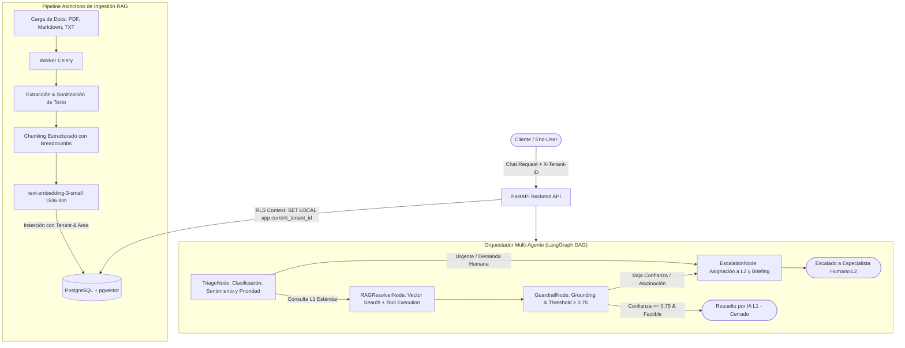

# Plataforma SaaS Multi-Tenant de Soporte L1 con IA, Agentes y Analítica

Arquitectura completa, modular y lista para producción de soporte L1 autónomo multi-tenant, impulsada por un grafo dirigido (DAG) con **LangGraph**, embeddings y búsqueda vectorial en **PostgreSQL + pgvector**, aislamiento estricto por **Row Level Security (RLS)**, ingestión asíncrona con **Celery + Redis**, API asíncrona con **FastAPI** y dashboard analítico en **Next.js (App Router)**.

---

## 🏛️ 1. Arquitectura General del Sistema



---

## 🗄️ 2. Base de Datos & Row Level Security (RLS)

Ubicación del script de migración SQL:
[`backend/migrations/001_initial_schema_and_rls.sql`](file:///c:/Users/beker/Desktop/hd/backend/migrations/001_initial_schema_and_rls.sql)

### Tablas Implementadas:
1. `tenants`: Aislamiento SaaS empresarial (`id`, `name`, `slug`, `config`).
2. `users`: Gestión de roles (`end_user`, `agent_l2`, `admin_area`, `super_admin`).
3. `areas`: Departamentos de atención (e.g. Soporte Técnico, Facturación, Seguridad).
4. `agent_areas`: Relación N:M entre agentes L2 y sus áreas de especialidad técnica.
5. `ticket_categories`: Categorías con SLAs definidos en horas.
6. `tickets`: Modelo central con estados, prioridades, tipificación de resolución (`resolved_by_ai`, `resolved_by_human`), sentimiento del cliente y deadline de SLA.
7. `ticket_messages`: Historial conversacional y trazas de razonamiento del agente.
8. `document_chunks`: Almacén vectorial con `vector(1536)` indexado con **HNSW** (`vector_cosine_ops`) y metadatos JSONB enriquecidos.

### Aislamiento por RLS:
Todas las tablas tienen `ROW LEVEL SECURITY` habilitado y políticas activas vinculadas a la variable de sesión:
```sql
current_setting('app.current_tenant_id', true)::UUID
```

---

## ⚙️ 3. Pipeline de Ingestión RAG

- **Extracción Sanitizada:** Soporte para archivos `.pdf` (mediante `pypdf`), `.md` y `.txt`, eliminando caracteres nulos y controlando espacios no estructurados.
- **Chunking Jerárquico con Contexto:** Mantiene la jerarquía del documento (`#`, `##`, `###`), inyectando en cada fragmento un encabezado con breadcrumbs (ejemplo: `[Context: Integración API > Autenticación > Tokens Bearer]`) para evitar la descontextualización semántica.
- **Vectorización & Almacenamiento:** Genera embeddings de 1536 dimensiones con `text-embedding-3-small` e inserta los chunks de forma asíncrona mediante **Celery** en `document_chunks`.

---

## 🤖 4. Flujo Multi-Agente (LangGraph DAG)

1. **`triage_node` (Triage & Clasificación):**
   - Extrae el sentimiento del cliente (`positive`, `neutral`, `frustrated`).
   - Calcula la severidad (`low`, `medium`, `high`, `critical`).
   - Asigna el departamento adecuado (`Technical Support`, `Billing & Subscriptions`, etc.).
   - Evalúa si el caso requiere derivación inmediata a un humano.

2. **`rag_resolver_node` (Resolución & Tool Calling):**
   - Realiza búsqueda de similitud de coseno en `pgvector` filtrada por `tenant_id` y `area_id`.
   - Ejecuta herramientas automáticas (inspección de suscripciones, estatus del servicio, purga de caché).
   - Genera respuesta fundamentada en fuentes oficiales con citas estructuradas.

3. **`guardrail_node` (Auditoría de Alucinación & SLA):**
   - Valida el grounding de la respuesta frente al contexto recuperado.
   - Aplica el umbral de corte de confianza configurado (`confidence_score >= 0.75`).
   - Si no cumple, activa la ruta de escalamiento.

4. **`escalation_node` (Escalamiento a L2):**
   - Consulta los agentes humanos en `agent_areas` asignados al área correspondiente.
   - Asigna el caso al agente disponible y calcula la fecha límite de SLA.
   - Genera una respuesta empática al usuario y un briefing técnico resumido para el agente L2.

---

## 📊 5. Frontend & Dashboard Analítico (Next.js)

Ubicación: [`frontend/`](file:///c:/Users/beker/Desktop/hd/frontend)

- **Simulador Interactivo:** Permite interactuar en tiempo real con el runtime del DAG, visualizando cada etapa (`TriageNode`, `RAGResolverNode`, `GuardrailNode`, `EscalationNode`) y las citas de fuentes consultadas.
- **Analítica Operativa:** Gráficos de área con **Recharts** para el volumen de tickets (IA vs Humano), desglose de sentimiento del cliente y métricas de SLA.
- **Cola de Tickets L2:** Vista de gestión para supervisores y agentes humanos con detalles técnicos y estados.
- **Gestión RAG:** Panel de carga de documentos y estado de la base vectorial.

---

## 🚀 6. Guía de Ejecución

### Opción A: Despliegue con Docker Compose (Recomendado)
```bash
cd backend
docker-compose up -d
```
Esto inicializa:
- PostgreSQL 16 con `pgvector` en el puerto `5432` y ejecuta la migración inicial.
- Redis en el puerto `6379`.
- Backend FastAPI en `http://localhost:8000` con documentación Swagger en `/api/v1/docs`.
- Worker Celery para ingestión de documentos.

### Opción B: Ejecución Local

**1. Backend (FastAPI):**
```bash
cd backend
python -m venv venv
# Windows:
.\venv\Scripts\activate
# Linux/Mac:
source venv/bin/activate

pip install -r requirements.txt
uvicorn app.main:app --reload --port 8000
```

**2. Worker de Ingestión (Celery):**
```bash
celery -A app.workers.celery_app.celery_app worker --loglevel=info
```

**3. Frontend (Next.js):**
```bash
cd frontend
npm run dev
```
Abre [http://localhost:3000](http://localhost:3000) en el navegador.
